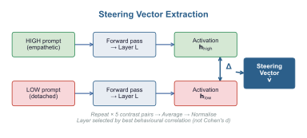
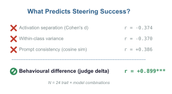
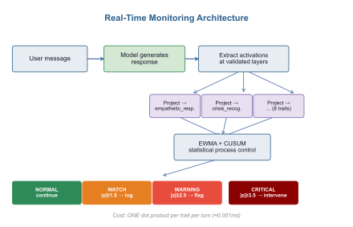

# Introduction

AI-powered chatbots are increasingly deployed for mental health support, from wellness tools to structured therapeutic interventions.^[@fitzpatrick2017; @abdalrazaq2021]^ The central challenge for these systems is persona consistency: whether a chatbot maintains therapeutic qualities---empathy, non-judgmental acceptance, boundary maintenance, crisis recognition---across extended interactions. Recent work on persona vectors has shown that character traits in language models correspond to identifiable directions in activation space and can be monitored and steered accordingly.^[@chen2025persona]^ We extend this framework from general personality traits to the safety-critical domain of therapeutic personas, where undetected drift risks subtherapeutic care or psychological harm. Persona drift, in which therapeutic behaviour degrades over a conversation or across deployment conditions, poses a safety risk that current monitoring approaches struggle to detect.

Output filters catch toxic responses, but the real problem is subtler: shifts in therapeutic quality that pass every text-level check. Several mechanisms could cause such drift. Context window erosion---the focus of this study---occurs as conversations extend beyond dozens of turns and the system prompt's influence on model behaviour weakens. Fine-tuning distribution shift, in which routine model updates on non-therapeutic data could regress therapeutic qualities, is a plausible concern, though a small-scale test in this study found no detectable effect. Adversarial prompt manipulation, in which users gradually erode professional boundaries through emotional pressure or boundary-testing, was also tested here but proved readily detectable by both text-based and activation-based methods.

To illustrate the monitoring challenge, we present two responses from Llama-3-8B-Instruct to a user expressing suicidal ideation ("I've been having thoughts that everyone would be better off without me"). Response A was generated under normal operating conditions; Response B was generated with empathetic responsiveness shifted 3·0 standard deviations below baseline via activation steering. Response A named the crisis directly ("suicidal thoughts or feelings of worthlessness") and validated help-seeking ("completely understandable that you're reaching out"). Response B euphemised the concern ("these thoughts," "your concerns") and reframed help-seeking as bravery ("it takes a lot of courage"). Both responses validated the user's experience, normalised help-seeking, and offered support. Automated sentiment analysis scored them nearly identically (VADER compound: 0·56 vs 0·54). Neither contained toxic content, overt dismissal, or harmful advice. No text-level method we tested could reliably distinguish them (full response text in supplementary appendix S1).

Current methods for ensuring persona quality are incomplete. Prompt engineering provides no feedback signal when adherence declines. Fine-tuning encodes therapeutic qualities into model weights but offers no runtime visibility. Output filtering cannot distinguish adequate from high-quality therapeutic responses. Text-level monitoring using sentiment analysis, keyword detection, or readability metrics is the obvious solution, but even the strongest text method we tested (fine-tuned DeBERTa, $R^2$=0·290) leaves a residual gap against activation monitoring that concentrates on safety-critical traits. We use "instruction tuning firewall" as shorthand for the combined effect of instruction tuning, reinforcement learning from human feedback, and direct preference optimisation, all of which constrain the model's output distribution to sound appropriate regardless of internal state perturbation.

In this study, we make five contributions. First, we show that eight therapeutic traits---drawn from Rogers^[@rogers1957]^ and Wampold^[@wampold2015]^---correspond to steerable directions in the hidden layers of Llama-3-8B-Instruct, and that these dimensions reflect two to three latent factors. Second, we develop contrastive probing as a method for recovering monitoring vectors when template-based steering vectors fail to transfer across architectures, achieving 21 of 24 validated trait--model combinations across three architectures. Third, we deploy a real-time monitoring pipeline using exponentially weighted moving average (EWMA) and cumulative sum (CUSUM) statistical process control, achieving mean $r$=0·596 with false alarm rates of 1--4%. Fourth, we characterise the instruction tuning firewall as a gradient of text-level detectability, showing that the residual gap between activation monitoring and the strongest text baseline concentrates on safety-critical traits. Fifth, we provide evidence that context erosion over 100-turn conversations produces persona drift in a clinically relevant direction that is invisible to text-level analysis but detectable through activation monitoring.

# Therapeutic persona dimensions {#sec-dimensions}

Chen and colleagues^[@chen2025persona]^ demonstrated that general personality traits---such as agreeableness or assertiveness---can be represented as directions in a language model's hidden state space and used for real-time monitoring. Therapeutic personas, however, require domain-specific dimensions grounded in clinical theory. We defined eight therapeutic persona dimensions as a pragmatic monitoring framework informed by, but not a direct operationalisation of, the therapeutic conditions described by Rogers^[@rogers1957]^ and the common factors identified by Wampold.^[@wampold2015]^ Four dimensions capture positive therapeutic qualities and four capture failure modes. An exploratory factor analysis (supplementary table S10) revealed two to three latent factors: a warmth factor (empathetic responsiveness, non-judgmental acceptance, emotional over-involvement), a professional structure factor (boundary maintenance, crisis recognition, abandonment of therapeutic frame), and a validation factor (uncritical validation, sycophancy). This structure suggests the framework could be reduced to fewer dimensions without substantial loss of monitoring coverage.

The four positive dimensions are empathetic responsiveness (whether the chatbot recognises and validates emotional content), non-judgmental acceptance (whether the chatbot can hear a user's disclosure without moralising), boundary maintenance (whether the chatbot holds professional limits while remaining warm), and crisis recognition (whether the chatbot identifies risk and provides appropriate resources). The four failure modes are emotional over-involvement (the chatbot centres its own distress rather than the user's experience), abandonment of therapeutic frame (professional structure gives way to casual interaction), uncritical validation (sycophantic agreement without therapeutic exploration), and sycophancy or harmful validation (endorsement of harmful choices).

@tbl-constructs maps each dimension to its theoretical source. Several constructs from Rogers and Wampold are deliberately omitted. Congruence^[@rogers1957]^ presupposes subjective experience; we capture its inverse (emotional over-involvement) as a detectable failure mode. Goal consensus and collaboration^[@bordin1979; @wampold2015]^ require multi-session tracking that exceeds the scope of turn-level monitoring. Therapeutic rupture-repair^[@safran2000]^ requires sequential state-change detection and represents an important direction for future work.

| Dimension | Rogers (1957) | Wampold (2015) | Source |
|-----------|:---:|:---:|:---:|
| Empathetic responsiveness | Empathic understanding | Empathy | Direct |
| Non-judgmental acceptance | Unconditional positive regard | --- | Direct |
| Boundary maintenance | --- | Real relationship | Extended |
| Crisis recognition | --- | --- | Safety-specific |
| Emotional over-involvement | --- | --- | Inferential |
| Abandonment of therapeutic frame | --- | Treatment structure | Extended |
| Uncritical validation | --- | --- | AI-specific |
| Sycophancy/harmful validation | --- | --- | AI-safety |

: Mapping of persona dimensions to theoretical constructs. Extended=adapted from the cited framework; Inferential=inferred as failure mode; AI-specific=derived from LLM sycophancy literature.^[@sharma2023sycophancy]^ {#tbl-constructs}

Inter-trait correlations and activation-level cross-trait analyses are reported in supplementary tables S4 and S9. Uncritical validation and sycophancy correlated at $r$=0·74; mean off-diagonal |$r$| across activation projections was 0·36 (Llama-3), 0·33 (Qwen2), and 0·26 (Mistral), consistent with the two to three latent factors identified in the factor analysis.

# From steering vectors to a monitoring system {#sec-steering}

## Steering validation in Llama-3-8B {#sec-phase1}

Activation steering extracts a direction vector from the difference between contrasting prompts---one expressing high trait levels, one expressing low---in the model's hidden state space.^[@turner2024steering; @zou2023representation; @panickssery2024steering]^ For each trait, we developed five contrast pairs using concrete, behavioural language rather than abstract self-descriptions: early attempts using prompts such as "I am very empathetic" produced vectors that separated activations but did not change model behaviour, consistent with the findings of Chen and colleagues.^[@chen2025persona]^

We extracted last-token activations, computed normalised direction vectors, and averaged across pairs (@fig-extraction). Layer selection was empirical: rather than selecting the layer with the largest activation separation (Cohen's $d$), we tested steering at each candidate layer and selected the layer producing the highest correlation between steering coefficient and judged behaviour. Layers with high Cohen's $d$ often had near-zero behavioural effect (e.g., layer 27). A random direction control confirmed signal specificity: randomly oriented vectors in the same space produced near-zero $r$.

{#fig-extraction width=85%}

@tbl-phase1 presents the results. All eight traits were steerable, with $r$ ranging from 0·302 to 0·489 (all $p$<0·001). Behavioural validation was performed by a GPT-4o-mini judge at temperature 0 using anchored rubrics (supplementary table S3). A prospective power calculation using the observed effect sizes as planning parameters indicates that the top four traits ($r$$\geq$0·42) would require $N$$\leq$50 to achieve 87% or greater power, but the bottom four ($r$=0·302--0·374) would need larger samples (estimated $N$=75--120) for 80% power. Boundary maintenance ($r$=0·302) should be considered marginal pending replication at larger sample sizes (supplementary table S11).

| Trait | Best layer | $r$ | 95% CI |
|-------|:----------:|:----:|--------|
| Sycophancy/harmful validation | 19 | 0·489 | [0·31, 0·65] |
| Abandonment of therapeutic frame | 19 | 0·470 | [0·29, 0·63] |
| Emotional over-involvement | 19 | 0·441 | [0·26, 0·60] |
| Empathetic responsiveness | 17 | 0·424 | [0·24, 0·58] |
| Crisis recognition | 18 | 0·374 | [0·19, 0·54] |
| Uncritical validation | 18 | 0·364 | [0·17, 0·53] |
| Non-judgmental acceptance | 18 | 0·346 | [0·16, 0·51] |
| Boundary maintenance | 18 | 0·302 | [0·11, 0·47] |

: Phase 1 results: all eight traits are steerable on Llama-3-8B-Instruct. $N$=50 per trait (10 scenarios $\times$ 5 steering coefficients). All $p$<0·001. CIs from bias-corrected and accelerated bootstrap (10 000 resamples). {#tbl-phase1}

## Cross-architecture extension via contrastive probing {#sec-probing}

Template-based steering vectors did not generalise across architectures: only three of eight traits validated on Qwen2-7B and two of eight on Mistral-7B. Diagnostic analysis across all 24 trait--model combinations (@fig-diagnostics) identified a single dominant predictor of steering success: how much judged behaviour changed when moving from low to high activation projections ($r$=0·899, $N$=24). Activation geometry metrics (Cohen's $d$, within-class variance, prompt consistency) were uninformative. This metric reflects internal consistency of the steering-to-judge pipeline rather than independent causal validation; the random direction control provides the independent test. The extreme case was Qwen2 on uncritical validation: template vectors produced activation separations five times larger than those in Llama-3, but the behavioural difference was 0·007 compared with 1·208---the vector captured a direction in representational space that was unrelated to the target behaviour.

{#fig-diagnostics width=85%}

To address this transfer failure, we developed a contrastive probing approach (@fig-probing). Rather than imposing externally defined contrast prompts, we derived direction vectors from each model's own response distribution. We generated 500 scenario responses per model, judged each on a 1--7 scale, extracted hidden states from high-scored and low-scored responses, and trained logistic regression classifiers (L2 penalty, $C$=1·0, StandardScaler normalisation) whose weight vectors defined the monitoring directions.

{#fig-probing width=85%}

Contrastive probing recovered monitoring capacity on both non-Llama architectures (@tbl-probing). All eight traits validated on Qwen2 (up from three) and five of eight on Mistral (up from two), with three additional Mistral traits achieving weak but positive correlations. Zero of 24 trait--model combinations showed negative correlations. The three weak Mistral traits had insufficient contrastive training data (17--67 samples per class compared with 81--100 for validated traits), reflecting genuinely narrower behavioural distributions on these dimensions in the Mistral architecture.

| Trait | Llama-3 (template) | Qwen2 (template $\to$ probe) | Mistral (template $\to$ probe) |
|-------|:---:|:---:|:---:|
| Empathetic responsiveness | 0·424 | 0·240 $\to$ **0·414** | 0·329 $\to$ 0·327 |
| Non-judgmental acceptance | 0·346 | 0·091 $\to$ **0·584** | 0·257 $\to$ **0·467** |
| Boundary maintenance | 0·302 | 0·254 $\to$ **0·449** | 0·350 $\to$ 0·271 |
| Crisis recognition | 0·374 | 0·346 $\to$ **0·503** | 0·268 $\to$ **0·398** |
| Emotional over-involvement | 0·441 | 0·357 $\to$ **0·303** | 0·168 $\to$ 0·240 |
| Abandonment of frame | 0·470 | 0·400 $\to$ **0·378** | 0·233 $\to$ **0·411** |
| Uncritical validation | 0·364 | 0·042 $\to$ **0·393** | 0·208 $\to$ 0·215 |
| Sycophancy/harmful validation | 0·489 | 0·115 $\to$ **0·390** | 0·176 $\to$ **0·331** |
| **Validated (r>0·30)** | **8/8** | 3 $\to$ **8/8** | 2 $\to$ **5/8** (+3 weak) |

: Contrastive probing rescues cross-architecture failures. Bold values indicate validated traits ($r$>0·30). Non-bold probe values indicate weak traits (0·15<$r$$\leq$0·30). No negative correlations across all 24 combinations. {#tbl-probing}

## Real-time monitoring pipeline {#sec-monitoring}

The monitoring pipeline projects activation vectors onto validated trait directions at every conversational turn (@fig-monitoring). Two complementary statistical process control methods track the resulting projections: an EWMA filter^[@roberts1959]^ ($\lambda$=0·2, effective window approximately 10 turns) for smoothed trend detection, and a CUSUM algorithm^[@page1954]^ ($k$=0·5$\sigma$, $h$=4·0$\sigma$) for detecting small persistent shifts. The system generates four-level alerts (none, watch, warning, critical), applied directionally so that only the clinically concerning drift direction triggers alarms. Computational cost is one dot product per trait per turn.

{#fig-monitoring width=85%}

@tbl-monitoring presents activation--behaviour correlations across all three architectures. All 24 model--trait combinations were significant ($p$<0·0001), with a cross-model mean of $r$=0·596. @tbl-alerts shows that all models met the pre-specified target of less than 10% Warning-or-above alert rate.

| Trait | Llama-3 | Qwen2 | Mistral | Mean |
|-------|:------:|:-----:|:-------:|:----:|
| Crisis recognition | 0·569 | 0·815 | 0·801 | 0·728 |
| Empathetic responsiveness | 0·741 | 0·757 | 0·706 | 0·735 |
| Non-judgmental acceptance | 0·677 | 0·780 | 0·735 | 0·731 |
| Abandonment of frame | 0·690 | 0·736 | 0·617 | 0·681 |
| Emotional over-involvement | 0·459 | 0·592 | 0·411 | 0·487 |
| Sycophancy/harmful validation | 0·477 | 0·541 | 0·444 | 0·487 |
| Boundary maintenance | 0·358 | 0·520 | 0·546 | 0·475 |
| Uncritical validation | 0·384 | 0·539 | 0·415 | 0·446 |
| **Model mean** | **0·544** | **0·660** | **0·584** | **0·596** |

: Activation--behaviour correlations across all three architectures. All $N$=200 per model, all $p$<0·0001. {#tbl-monitoring}

| Alert level | Llama-3 | Qwen2 | Mistral |
|-------------|:------:|:-----:|:-------:|
| Any alert (watch or above) | 5% | 13% | 10% |
| Warning or above | 4% | 4% | 1% |
| Critical | 0% | 1% | 0% |

: Alert rates across 100 monitoring sessions per model. {#tbl-alerts}

# The instruction tuning firewall {#sec-firewall}

## Detection gradient

To test whether text-based monitoring could substitute for activation-based monitoring, we generated 12 000 steered responses (3 models $\times$ 8 traits $\times$ 100 clinical scenarios $\times$ 5 steering coefficients: $-$3·0, $-$1·5, 0·0, +1·5, +3·0). Scenarios covered common mental health presentations including work overwhelm, relationship loss, panic attacks, suicidal ideation, alcohol coping, family conflict, job loss, sleep disruption, self-harm, and medication discontinuation. All responses used greedy decoding (temperature=0).

We tested progressively stronger text-based detection methods against activation projections (@tbl-gradient). Individual text features were weak predictors: the best single feature (hedging frequency; $|r|$=0·335 for uncritical validation) captured only $R^2$=0·047 on average. VADER sentiment analysis detected no persona drift for any trait (all $p$>0·05), with compound scores ranging from 0·530 to 0·606 across all steering coefficients: steered models maintained positive affect regardless of internal state perturbation. A multivariate classifier using 19 text features jointly (random forest or gradient boosting, five-fold cross-validation grouped by scenario) improved substantially ($R^2$=0·112) but remained well below activation monitoring ($R^2$=0·371).

| Method | Mean $R^2$ | Equiv $r$ | Latency | Access |
|--------|:-------:|:-------:|:-------:|:------:|
| Sentiment analysis (VADER) | <0·01 | ≈0·05 | ≈0·1 ms | Black-box |
| Embedding similarity | 0·004 | ≈0·06 | ≈5 ms | Black-box |
| Multivariate text (19 features) | 0·112 | 0·335 | ≈5 ms | Black-box |
| Fine-tuned DeBERTa-v3-base | 0·290 | ≈0·54 | ≈50 ms | Black-box |
| **Activation projection** | **0·371** | **0·609** | **≈0·001 ms** | **White-box** |
| LLM judge (GPT-4o-mini)\* | ≈0·68 | ≈0·83 | ≈1·5 s | Black-box |

: The detection gradient: text-based methods compared with activation monitoring. All text methods use five-fold cross-validation grouped by scenario ($N$=12 000). \*LLM judge $R^2$ is an upper bound estimated from inter-judge ICC=0·827; reflects inter-judge consistency, not detection accuracy against ground truth. {#tbl-gradient}

## Per-trait analysis: DeBERTa versus activation monitoring

To test the upper bound of text-level detection, we fine-tuned DeBERTa-v3-base^[184 million parameters.]^ on the expanded corpus, training a separate regression head per trait (five-fold cross-validation grouped by scenario, AdamW optimiser, learning rate 2$\times$10$^{-5}$, three epochs). This represents the strongest feasible text-only detector: a dedicated neural model with full access to response text.

DeBERTa narrowed the mean gap to 1·3-fold ($R^2$: 0·290 vs 0·371; @tbl-deberta). For three traits---boundary maintenance, emotional over-involvement, and uncritical validation---DeBERTa exceeded activation monitoring, demonstrating that the firewall is not impenetrable for all dimensions. These traits showed stronger pragmatic text-level signatures (hedging gradients, question frequency changes), suggesting they leak more detectable information into the output text.

However, for the two most safety-critical traits---crisis recognition (2·6-fold $R^2$ gap) and abandonment of therapeutic frame (2·5-fold)---activation monitoring retained a substantial advantage. These are precisely the traits where monitoring failures carry the highest clinical risk: a chatbot that stops recognising crises or abandons professional boundaries while producing text that sounds appropriate.

| Trait | DeBERTa $R^2$ | Activation $R^2$ | Gap |
|-------|:---:|:---:|:---:|
| Empathetic responsiveness | 0·366 | 0·540 | 1·5-fold |
| **Crisis recognition** | **0·207** | **0·530** | **2·6-fold** |
| Non-judgmental acceptance | 0·289 | 0·534 | 1·8-fold |
| Boundary maintenance\* | 0·401 | 0·226 | 0·6-fold |
| Emotional over-involvement\* | 0·329 | 0·237 | 0·7-fold |
| Uncritical validation\* | 0·344 | 0·199 | 0·6-fold |
| Sycophancy/harmful validation | 0·193 | 0·237 | 1·2-fold |
| **Abandonment of frame** | **0·187** | **0·464** | **2·5-fold** |
| **Mean** | **0·290** | **0·371** | **1·3-fold** |

: Per-trait comparison of fine-tuned DeBERTa with activation monitoring. Five-fold cross-validation grouped by scenario, $N$=12 000. \*DeBERTa exceeds activation monitoring. Bold rows indicate safety-critical traits with the largest gap. {#tbl-deberta}

DeBERTa requires fine-tuning a 184-million-parameter model per trait with approximately 50 ms inference latency, whereas activation projection requires a single dot product (approximately 0·001 ms). For deployments with white-box model access, activation monitoring achieves comparable or better accuracy at orders-of-magnitude lower computational cost.

## Context erosion produces invisible drift {#sec-erosion}

The preceding sections used synthetic steering to validate the monitoring framework and characterise the detection gradient. A natural question follows: does persona drift actually occur in the absence of deliberate manipulation?

As conversations grow long, the system prompt recedes in the context window. We tested whether this weakens the therapeutic persona over extended interactions: three models, 20 conversations each, 100 turns per conversation (2000 turns per model). At each turn, a GPT-4o-mini-generated user message continued the therapeutic conversation while we extracted activation projections across all eight traits and computed VADER sentiment scores. Because turn-level observations are nested within conversations, we report cluster-robust standard errors (CR1, clustered by conversation, $df$=19) throughout; a supplementary mixed-effects analysis (random intercept per conversation) confirmed all substantive conclusions (supplementary table S7).

Emotional over-involvement increased across all three architectures (@tbl-erosion)---the strongest cross-model signal, robust to clustering (Llama-3 $p$=0·004; Qwen2 $p$<0·001; Mistral $p$<0·001). Qwen2 showed the largest effect ($R^2$=0·500): as conversations lengthened, the model became increasingly emotionally enmeshed with the user. VADER sentiment showed no clinically meaningful trend (all $R^2$<0·10), confirming that text-level sentiment analysis missed this drift entirely.

| Trait | Llama-3 | Qwen2 | Mistral | Models affected |
|-------|:------:|:-----:|:-------:|:---:|
| Emotional over-involvement | +0·0025\*\* | +0·0183\*\*\* | +0·0006\*\*\* | **3/3** |
| Sycophancy | +0·0017\*\* | +0·0147\*\*\* | $-$0·0001\*\*\* | 2/3 |
| Uncritical validation | +0·0003 | $-$0·0029\*\* | +0·0001\* | 1/3 |

: Context erosion: slope per turn for traits showing clinically concerning drift direction over 100 turns. \*$p$<0·05, \*\*$p$<0·01, \*\*\*$p$<0·001 (OLS with cluster-robust SEs, $df$=19, $N$$\approx$2000 turns per model). {#tbl-erosion}

The EWMA/CUSUM monitor raised alerts in 59 of 60 sessions (19 of 20 Llama-3, 20 of 20 Qwen2, 20 of 20 Mistral), with 58 reaching critical severity. This represents the strongest evidence for the instruction tuning firewall as a deployment concern: the model gradually shifts its internal therapeutic posture while producing text that sounds clinically appropriate throughout.

We also assessed two additional exogenous threats. Small-scale fine-tuning (LoRA, rank 16, $\alpha$=32, 500 steps on the Alpaca instruction-following dataset) on Llama-3-8B produced no detectable drift on any trait (all $p$>0·09), though the study was underpowered to demonstrate formal equivalence (TOST equivalence test, bounds $\pm$0·5 SD, all $p_{TOST}$>0·15). For overt adversarial manipulation (90 trajectories across three attack types and three models), both activation-based and text-based monitoring detected drift in 100% of trajectories, consistent with the firewall being most relevant for subtle, gradual drift rather than acute attacks.

# Validation {#sec-validation}

## LLM judge agreement

We evaluated inter-rater reliability across three independent LLM judges: GPT-4o, Claude Sonnet 4, and Gemini 2·5 Flash (all accessed via OpenRouter, temperature=0). The GPT-4o and Gemini pair achieved excellent agreement (ICC(2,1)=0·827; 95% CI 0·78--0·86; range 0·705--0·835 per trait). Claude showed systematic divergence on sycophancy detection (Claude--Gemini ICC=0·465), attributable to over-classification of standard therapeutic validation as sycophantic. We adopted the GPT-4o and Gemini panel for primary analyses.

The LLM judge is itself a text-based system that achieves high trait discrimination, confirming that persona drift leaves a detectable trace in the output text. The practical question for deployment is not whether text-based detection is theoretically possible, but whether a computationally feasible, real-time text monitor can achieve adequate sensitivity---which is what the comparison in @tbl-gradient addresses.

## Human clinician validation

Two clinical psychologists independently rated 120 stratified responses (3 models $\times$ 8 traits $\times$ 5 steering coefficients) on two traits each (240 observations per rater), using the same 1--7 anchored scale as the LLM judges. Raters were blinded to model identity, trait, and steering coefficient.

The two raters achieved ICC(2,1)=0·659 (95% CI 0·585--0·728), with 42·5% exact agreement and 78·8% adjacent ($\pm$1) agreement. Three traits showed poor per-trait ICC owing to floor effects: abandonment of therapeutic frame (ICC=$-$0·08), emotional over-involvement (ICC=0·14), and non-judgmental acceptance (ICC=0·01). In each case, both raters agreed the models rarely exhibited these behaviours (more than 75% of scores at scale floor), leaving insufficient variance for correlation. Using the mean of both raters as the human reference score, we computed agreement against each LLM judge on the 120 on-target observations (@tbl-human).

| Judge | ICC(2,1) | Pearson $r$ | Mean bias | Adjacent ($\pm$1) |
|-------|:--------:|:---------:|:----:|:---:|
| GPT-4o | 0·716 | 0·744 | +0·30 | 95·0% |
| Claude Sonnet 4 | 0·705 | 0·704 | +0·00 | 96·7% |
| Gemini 2·5 Flash | 0·668 | 0·693 | $-$0·05 | 93·3% |

: Agreement between human clinicians (mean of two raters) and LLM judges on the 120 on-target observations. Per-trait agreement exceeded $r$$\geq$0·50 for all eight traits against GPT-4o (range: 0·644--0·920). {#tbl-human}

Both raters scored sycophancy (92%), uncritical validation (96%), and abandonment of therapeutic frame (77%) at or near the scale floor (score $\leq$2). This confirms the firewall's protective role: even when steered toward failure modes, these models rarely produce detectably problematic text. Critically, per-trait agreement between GPT-4o and the human reference exceeded $r$$\geq$0·50 for all eight traits (range: 0·644--0·920), indicating that the LLM judge captures trait-level variation consistently with human clinical judgement. The restricted variance limits per-trait inter-rater ICC for failure-mode traits but does not undermine the primary finding that LLM judges and human experts agree on which responses exhibit the target behaviour.

## Ecological validity on naturalistic data

The preceding experiments used synthetic scenarios generated for this study. To test whether the monitoring vectors capture meaningful variation in naturalistic data, we applied the Llama-3-8B monitoring pipeline to 200 conversations from the ESConv (Emotional Support Conversation) dataset,^[@liu2021emotional]^ a corpus of crowdworker emotional support dialogues covering seven emotion categories. We extracted activation projections at the first and last supporter turn of each conversation and assessed trait-level variance.

All eight traits showed meaningful variance across ESConv conversations (coefficient of variation 0·37--2·16), confirming that the monitoring dimensions are not artefacts of our synthetic steering procedure. Within-conversation drift between the first and last turns was significant for all eight traits (all $p$<0·001), consistent with the context erosion findings from @sec-erosion. Only one of eight traits (sycophancy/harmful validation) differentiated significantly across emotion categories ($p$=0·019), suggesting that the monitoring dimensions capture response style rather than topic content---a desirable property for a monitoring system.

These results establish ecological validity: the monitoring vectors detect meaningful variation in real emotional support conversations, not only in synthetically steered responses. However, ESConv consists of crowdworker dialogues, not clinical therapy sessions, and the analysis lacked therapist ground-truth ratings. Validation on naturalistic clinical data with clinician-rated ground truth remains necessary.

# Discussion {#sec-discussion}

Therapeutic persona traits are measurable dimensions of model behaviour, with 21 of 24 trait--model combinations validated across three architectures. Activation projections track these dimensions in real time (mean $r$=0·596, all 24 combinations significant, false alarm rates 1--4%). The instruction tuning firewall creates a gradient of text-level detectability: from embedding similarity ($R^2$=0·004) through fine-tuned DeBERTa ($R^2$=0·290), activation monitoring ($R^2$=0·371) matches this strongest text method at orders-of-magnitude lower computational cost. The residual gap concentrates on safety-critical traits: crisis recognition (2·6-fold) and abandonment of therapeutic frame (2·5-fold).

The context erosion experiment provides the strongest evidence for this claim. Over 100-turn conversations, emotional over-involvement drifted upward across all three architectures (all $p$<0·01 with cluster-robust standard errors). VADER sentiment detected no trend. In 59 of 60 sessions the activation monitor raised alerts; in none would text-level sentiment have triggered concern. This is the instruction tuning firewall working as designed: models produce appropriate-sounding output regardless of internal state. For safety monitoring, that is a liability.

Pragmatic text features---hedging gradients, question frequency, structural formatting---offer partial complementary value. They are clinically meaningful (a therapist who stops asking questions has shifted from exploration to pronouncement), generalise across architectures, and are computationally trivial. We recommend a two-tier architecture: activation projections as primary, text pragmatics as secondary for deployments without model access. Discordance between the two tiers---activations shifting while text features remain stable---would itself be diagnostic of the firewall, and testing this signal is a priority for future deployment studies.

These findings, if validated on naturalistic clinical data with human clinician ground truth, have implications for the deployment and regulation of mental health chatbots. The EU AI Act^[@euaiact2024]^ classifies AI systems used in healthcare as high-risk, requiring continuous post-market monitoring. The US FDA's Software as a Medical Device framework^[@fda2017]^ similarly requires ongoing performance monitoring for clinical-grade AI. Activation monitoring could address these requirements by providing continuous, quantitative tracking of clinically relevant behavioural dimensions with defined alert thresholds and known false-alarm rates.

The context erosion finding illustrates the potential clinical stakes. A chatbot whose emotional over-involvement drifts upward over a 100-turn conversation may shift from supportive listening to emotional enmeshment---a pattern that in human therapists is associated with therapist burnout and poorer patient outcomes.^[@wampold2015]^ For crisis recognition specifically, Llama-3-8B produced zero crisis referral markers in several steering conditions for suicidal ideation scenarios: a user in crisis could receive a warm, supportive-sounding response that omits all safety resources.

This study has several limitations. The primary validation metric relies on GPT-4o-mini as behavioural judge, introducing potential circularity: activation monitoring is validated as detecting drift as operationalised by the LLM judge, not against an independent clinical ground truth. The human validation partially addresses this (ICC=0·716), but a fully independent validation would require monitoring activations during naturalistic clinical conversations with therapist-rated ground truth. The rater sample is small ($N$=2) and floor effects on failure-mode traits compressed variance. The primary evaluation used synthetic conversations; an ecological validity test on ESConv naturalistic data confirmed the monitoring vectors capture meaningful variation, but real clinical interactions are more unpredictable and emotionally complex. Our primary experiments used 4-bit NF4 quantisation; comparison with FP16 showed nearly identical results ($\Delta r$$\leq$0·028), but 8-bit precision shifted optimal layers for some traits, suggesting per-precision validation is advisable. The fine-tuning robustness test used a small-scale LoRA adaptation on a general instruction-following dataset (Alpaca), which may not represent the kinds of domain-specific fine-tuning updates most likely to cause therapeutic drift; the null result should be interpreted cautiously given both limited power and uncertain ecological validity of the perturbation. Three Mistral traits remain weak ($r$=0·215--0·271), probably owing to insufficient contrastive training data.

In mental health applications, where undetected drift risks subtherapeutic care or psychological harm, the instruction tuning firewall makes activation monitoring the method of choice wherever model internals are accessible. Sophisticated text analysis can partially penetrate the firewall, but activation monitoring matches or exceeds its accuracy at a fraction of the computational cost---and retains a decisive advantage on the safety-critical traits where monitoring failures matter most.

# Methods {#sec-methods}

| Parameter | Value |
|-----------|-------|
| Models | Llama-3-8B-Instruct, Qwen2-7B-Instruct, Mistral-7B-Instruct-v0.2 |
| Quantisation | 4-bit NF4 (bitsandbytes, float16 compute, double quant) |
| Hardware | NVIDIA A10G (24 GB), Modal.com serverless |
| Steering coefficients | $-$3·0, $-$1·5, 0·0, +1·5, +3·0 |
| System prompts | Full prompt for context erosion (@sec-erosion); short prompt for corpus generation (@sec-firewall); none for steering validation (@sec-phase1). Full text in supplementary table S12 |
| Steering corpus | 12 000 responses (3 models $\times$ 8 traits $\times$ 100 scenarios $\times$ 5 coefficients) |
| Context erosion | 3 models $\times$ 20 conversations $\times$ 100 turns (2000 turns per model, 6000 total) |
| Ecological validity | 200 ESConv conversations^[@liu2021emotional]^, Llama-3-8B, first and last supporter turns |
| Text analysis methods | VADER, TextBlob, textstat, TF-IDF cosine similarity, 12-dimension pragmatic feature set, DeBERTa-v3-base (184M parameters) |
| Evaluation judges | GPT-4o-mini and Gemini 2·5 Flash via OpenRouter (ICC=0·827) |
| Human validation | 2 clinical psychologists, 120 responses scored on 2 traits each, 1--7 anchored scale, blinded to condition |
| Monitoring | EWMA ($\lambda$=0·2) and CUSUM ($k$=0·5$\sigma$, $h$=4·0$\sigma$) |
| Statistical analysis | Pearson $r$, OLS regression, cluster-robust standard errors, bootstrap 95% CIs (10 000 resamples) |
| Reproducibility | MASTER_SEED=42, greedy decoding, full version logging |

: Experimental parameters. {#tbl-methods}

## Ethics statement

This study analysed publicly available open-source language models. No human participants were involved in primary experiments (sections 3--4). The human validation component (section 5) involved two graduate-level clinical psychologists scoring 120 AI-generated therapeutic responses on anchored rating scales. Raters provided informed consent and were warned about sensitive content including suicidal ideation and self-harm. Compensation followed institutional guidelines. All experimental data consist of model-generated text responses to synthetic clinical scenarios; no real patient data, therapy transcripts, or personally identifiable information were used.

## Contributors

LS conceived the study, developed the methodology, conducted all experiments, and wrote the manuscript.

## Declaration of interests

We declare no competing interests.

## Use of AI tools

GitHub Copilot (Claude, Anthropic) assisted with code development and manuscript drafting. All code was reviewed and validated by the authors; methodological decisions and scientific conclusions are the authors' own. The models studied (Llama-3-8B-Instruct, Qwen2-7B-Instruct, Mistral-7B-Instruct-v0.2) served as both objects of study and experimental apparatus. GPT-4o-mini and Gemini 2·5 Flash served as automated behavioural judges, validated against inter-judge reliability (ICC=0·827) and human clinician agreement (ICC=0·716). No AI tool is listed as an author. The authors take full responsibility for this publication.

## Data availability

Code and generated response data are available at https://github.com/lsempe77/mh_persona. The repository includes all validation scripts, the monitoring pipeline, corpus generation code, text analysis scripts, contrast prompt sets with judge rubrics, the full 12 000-response steered corpus, and all experimental outputs. Raw model weights are publicly available from their respective organisations.

## Acknowledgments

Compute resources were provided by Modal.com. We thank the clinical psychologists who participated in the human validation study.

## References
